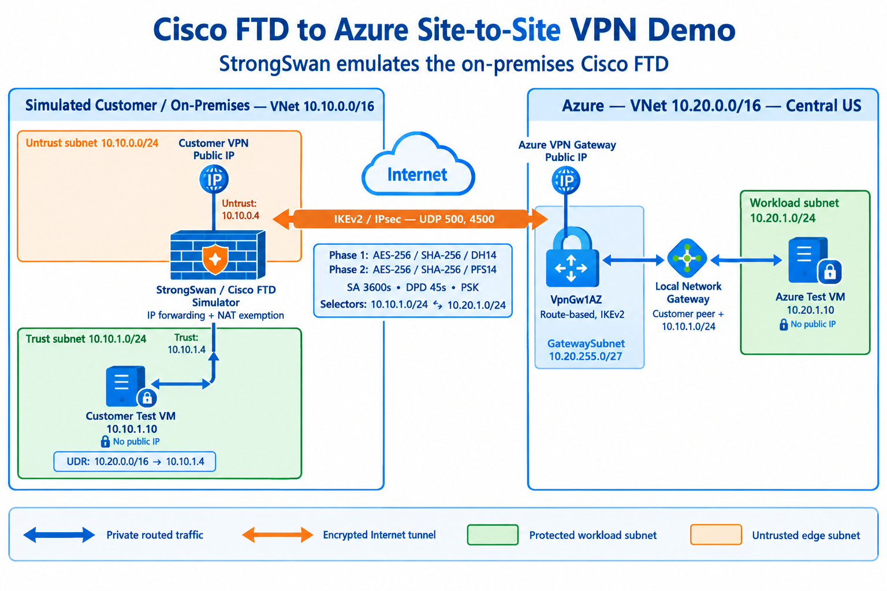

# Customer Terraform S2S VPN Demo

This self-contained lab deploys a simulated customer network with StrongSwan acting like a Cisco FTD. The IPsec tunnel terminates on an Azure `VpnGw1AZ`.



## Package contents

| File | Purpose |
|---|---|
| `main.tf` | Defines the Azure networks, security groups, routes, public IPs, virtual machines, VPN Gateway, Local Network Gateway, VPN connection, and StrongSwan configuration extension. |
| `variables.tf` | Declares customer inputs such as the subscription, region, naming prefix, SSH public key, VPN PSK, and tags. |
| `providers.tf` | Configures the AzureRM provider to deploy into the selected subscription. |
| `versions.tf` | Defines compatible Terraform and AzureRM provider versions. |
| `outputs.tf` | Displays the resource group, gateway public IPs, connection name, and test VM names after deployment. |
| `scripts/configure-strongswan.sh` | Installs and configures StrongSwan, IP forwarding, firewall rules, NAT exemption, IPsec policy, and service startup. |
| `terraform.tfvars.example` | Provides a non-secret template for customer-specific settings. |
| `.terraform.lock.hcl` | Locks the tested provider version and checksums for repeatable deployments. |
| `.gitignore` | Prevents local state, plans, secrets, customer settings, and provider caches from entering source control. |
| `Deploy-Demo.ps1` | Validates prerequisites and runs Terraform initialization, formatting, validation, planning, and optional deployment. |
| `Destroy-Demo.ps1` | Destroys the demo and removes local state artifacts only after Terraform reports a successful destroy. |
| `Test-Demo.ps1` | Checks the Azure VPN connection, StrongSwan security associations, and bidirectional private-IP connectivity. |
| `Cisco-FTD-Settings.md` | Maps the demo settings to Cisco FTD/FMC site-to-site VPN configuration concepts. |
| `architecture.png` | Shows the customer simulator, VPN tunnel, Azure VPN Gateway, and test workload topology. |

## Demo values

| Item | Value |
|---|---|
| Customer VNet | `10.10.0.0/16` |
| Customer protected subnet | `10.10.1.0/24` |
| Customer test VM | `10.10.1.10` |
| VPN appliance trust IP | `10.10.1.4` |
| Azure VNet | `10.20.0.0/16` |
| Azure workload subnet | `10.20.1.0/24` |
| Azure test VM | `10.20.1.10` |
| GatewaySubnet | `10.20.255.0/27` |
| VPN Gateway | `VpnGw1AZ`, route-based |
| IKE | IKEv2, AES-256, SHA-256, DH14 |
| IPsec | AES-256, SHA-256, PFS14, 3,600-second SA |
| Traffic selectors | `10.10.1.0/24` ↔ `10.20.1.0/24` |

## Prerequisites

- Azure CLI and Terraform.
- `az login` completed.
- Azure permissions to create resource groups, networks, VMs, public IPs, and VPN Gateway resources.
- SSH public key at `$HOME\.ssh\id_ed25519.pub`.
- Quota for three `Standard_B1s` VMs and one `VpnGw1AZ`.
- Address ranges that do not overlap existing customer or Azure networks.

## Create your local settings

Copy the example file and adjust only non-secret values:

```powershell
Copy-Item .\terraform.tfvars.example .\terraform.tfvars
```

`terraform.tfvars` is excluded from Git. Do not place the VPN PSK or private SSH key in it.

Set the Azure and SSH values in the current PowerShell session:

```powershell
$env:TF_VAR_subscription_id = az account show --query id --output tsv
$env:TF_VAR_admin_ssh_public_key = (Get-Content "$HOME\.ssh\id_ed25519.pub" -Raw).Trim()
```

Generate a 32-byte random PSK locally:

```powershell
$bytes = New-Object byte[] 32
[System.Security.Cryptography.RandomNumberGenerator]::Fill($bytes)
$psk = [Convert]::ToBase64String($bytes)
$env:TF_VAR_vpn_shared_key = $psk
[Array]::Clear($bytes, 0, $bytes.Length)
```

Store `$psk` in your approved password manager if it will also be configured on a real Cisco FTD. Do not email it, commit it, or add it to a tfvars file.

## Choose where Terraform state is stored

Terraform state contains the VPN PSK even though the variable is marked sensitive.

### Local state

Local state is the default for this disposable demo:

- Terraform writes `terraform.tfstate` in this folder.
- `.gitignore` excludes state, plans, local tfvars, and provider caches.
- Never email, copy, or commit state files.
- Keep state until `terraform destroy` succeeds.
- `Destroy-Demo.ps1` removes the Azure resources and local state artifacts.

### Customer-managed remote state

Teams can add their standard remote backend before `terraform init`. For Azure Storage, protect the account and container with Entra ID/RBAC, encryption, restricted network access, and appropriate retention controls.

Example backend declaration:

```hcl
terraform {
  backend "azurerm" {}
}
```

Supply the customer-owned backend settings during `terraform init`; do not hardcode credentials in Terraform files.

## Preview

```powershell
.\Deploy-Demo.ps1
```

## Deploy

After reviewing the plan:

```powershell
.\Deploy-Demo.ps1 -Apply
```

VPN Gateway provisioning commonly takes longer than the VM and network resources.

## Test

```powershell
.\Test-Demo.ps1
```

Expected results:

- Established StrongSwan IKE and CHILD security associations.
- Customer-to-Azure ping: 0% packet loss.
- Azure-to-customer ping: 0% packet loss.

## Configure a real Cisco FTD

Terraform configures the StrongSwan simulator automatically. For a real Cisco FTD:

1. Use `terraform output azure_gateway_public_ip` as the remote peer.
2. Use `10.10.1.0/24` as the customer protected network.
3. Use `10.20.1.0/24` as the Azure protected network.
4. Configure the IKE/IPsec values in the table above.
5. Configure the same value held in `$env:TF_VAR_vpn_shared_key` on the FTD.
6. Configure NAT exemption, routing, access-control rules, and UDP 500/4500.

See `Cisco-FTD-Settings.md` for the detailed mapping.

## Destroy

```powershell
.\Destroy-Demo.ps1 -ConfirmDestroy
```

## Microsoft Learn

- [Create a site-to-site VPN connection](https://learn.microsoft.com/azure/vpn-gateway/tutorial-site-to-site-portal)
- [VPN devices and IPsec/IKE parameters](https://learn.microsoft.com/azure/vpn-gateway/vpn-gateway-about-vpn-devices)
- [Configure custom IPsec/IKE policies](https://learn.microsoft.com/azure/vpn-gateway/ipsec-ike-policy-howto)
